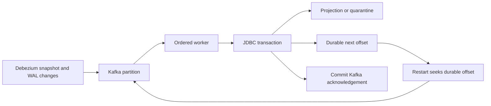

# CDC Recovery Lab

A Scala data-replication worker that survives a failure between applying a change and acknowledging its Kafka offset. Projection updates, poison-record quarantine, and the durable checkpoint commit in one JDBC transaction. A restart seeks to that checkpoint and safely skips replayed offsets.

**Portfolio focus:** CDC recovery, Scala asynchronous streams, Kafka offsets, JDBC consistency, and production troubleshooting.

## Run the recovery demonstration

Requires JDK 21+ and sbt. Docker is optional.

```sh
./scripts/sbtw test demo
```

The demo creates a separate persistent H2 database under `.data/`, injects a failure before commit, closes the sink after a successful commit without a source acknowledgement, and reopens it. Expected evidence:

```text
outcomes: duplicate, duplicate, applied, quarantined, applied, applied
projection: customer-a, tier=gold
checkpoint: customers / partition 0 / nextOffset=6
quarantine: offset 3, missing primary key
```

The JSON report includes the final database state and is saved beside the demo database. See [the recorded example](docs/recovery-example.json).

## How it works



File mode uses Pekko Streams, 1 MiB framed JSONL records, `mapAsync(1)`, and a count accumulator. It keeps processing memory bounded independently of file length. Kafka mode polls batches of at most 100 and processes records sequentially; it does not wrap `KafkaConsumer` in an asynchronous stream because that API is thread confined. Apache Pekko's stream model is close to Akka Streams and keeps this example openly runnable. [Pekko documentation](https://pekko.apache.org/docs/pekko/1.1/stream/stream-quickstart.html).

Offsets are stored as the **next** offset. Kafka offset gaps are allowed because compaction can remove records. On assignment, the durable checkpoint takes precedence over the group's offset. A checkpoint outside the retained log fails closed. An empty sink starts at the beginning of the retained log; it cannot reconstruct history already removed by retention.

The guarantee is idempotent application by topic/partition/offset into this database, with at-least-once source delivery. It does not provide a transaction spanning Kafka and PostgreSQL. The recovery decisions are documented in [the ADR](docs/adr.md).

## Process a file and inspect persistent state

```sh
./scripts/sbtw 'run file fixtures/changes.jsonl'
./scripts/sbtw 'run inspect'
```

Replaying the same file produces six duplicates. The fixture wrapper uses string offsets so 64-bit values survive JSON parsing. Debezium values may be schema wrapped or schema free. Supported operations: `r`, `c`, `u`, `d`, plus null tombstones. This example supports one table with string primary keys named `id`. Numeric/composite keys, schema migrations, transaction boundary events, and multiple source tables need an explicit extension.

## Real PostgreSQL → Debezium → Kafka → PostgreSQL setup

```sh
docker compose up -d --build
./scripts/register-connector.sh
curl http://localhost:8083/connectors/customers-cdc/status
docker compose exec -T source-db psql -U demo -d app -c "UPDATE customers SET tier='gold' WHERE id='customer-a';"
docker compose exec -T sink-db psql -U demo -d sink -c 'SELECT * FROM projection; SELECT * FROM checkpoints;'
curl http://localhost:8081/metrics
```

The connector performs the initial snapshot, then follows PostgreSQL logical replication using `pgoutput`, routing this one table to `customers`. The configuration follows [Debezium's PostgreSQL connector documentation](https://debezium.io/documentation/reference/3.0/connectors/postgresql.html). The [Kafka image configuration](https://kafka.apache.org/40/getting-started/docker/) uses a single local broker. All exposed ports bind to localhost and the `demo` credentials are for this synthetic environment.

To run the worker from your host against those services:

```sh
JDBC_URL=jdbc:postgresql://localhost:5433/sink DB_USER=demo DB_PASSWORD=demo ./scripts/sbtw 'run kafka'
```

Stop the Compose worker first so the host process gets the partitions. Use `KAFKA_CLIENT_PROPERTIES` to load Java Kafka TLS/SASL properties from a mounted secret file. Kubernetes manifests reference an existing `cdc-sink` Secret; no production credentials are included.

`docker compose down` stops the demo and preserves volumes. Removing those volumes discards the demo's database and Kafka history. Do that only when intentionally resetting the local experiment.

## Tests and operating limits

Eight tests cover transaction rollback, persistent restart, duplicate/stale offsets, poison rollback, delete/tombstone handling, partition independence, invalid envelopes, and retention/truncation refusal. The packaged jar is also exercised by CI:

```sh
./scripts/sbtw assembly
java -jar target/scala-2.13/cdc-recovery-lab.jar demo
```

Local validation used H2 and synthetic records. The Docker Compose stack and Kubernetes manifest require execution on a Docker/cluster host; they were not run in the development environment. H2 is not a substitute for PostgreSQL integration and isolation testing.

Scale is deliberately conservative: one in-flight transaction per process, one connection, per-record acknowledgement. Increase concurrency only while preserving per-partition order and introduce partition ownership fencing before distributing write execution. Keep an entity on the same partition; changing partition counts or reusing a topic name requires a migration/lineage strategy. Quarantine retains raw records and needs access control and retention policy. Fixing a quarantined record requires an audited repair at a new offset or a snapshot rebuild; replaying its old offset is intentionally skipped.

See [the incident runbook](docs/runbook.md) for safe recovery steps.
